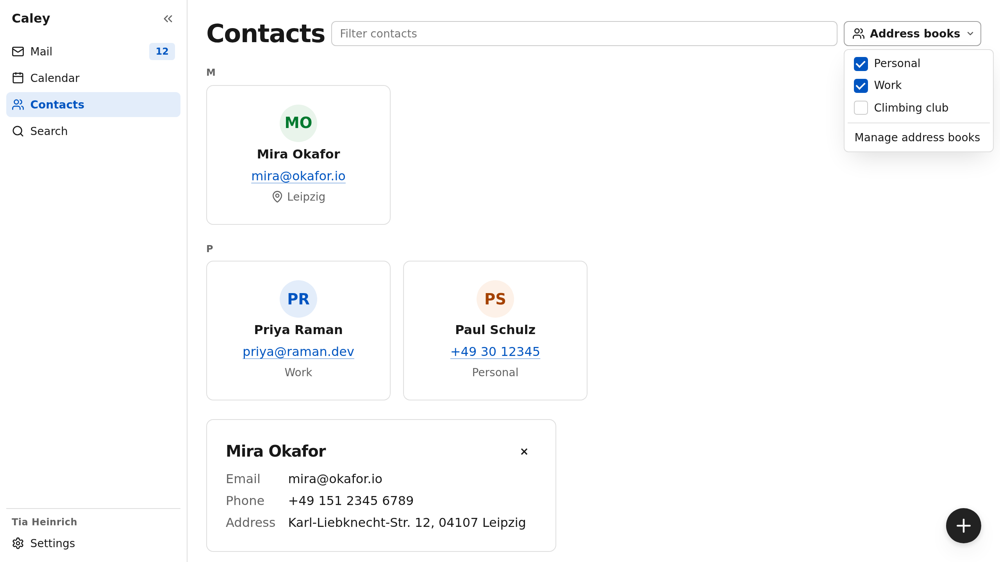
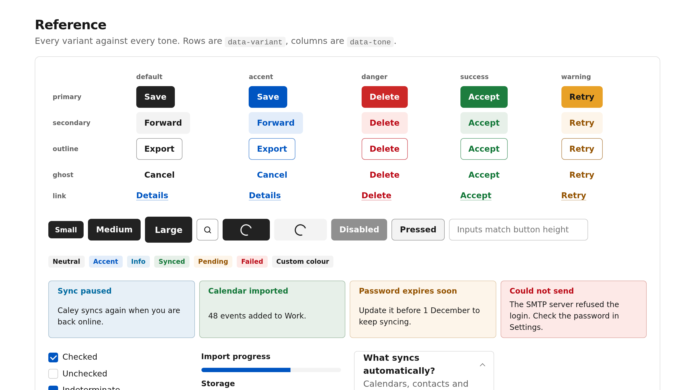
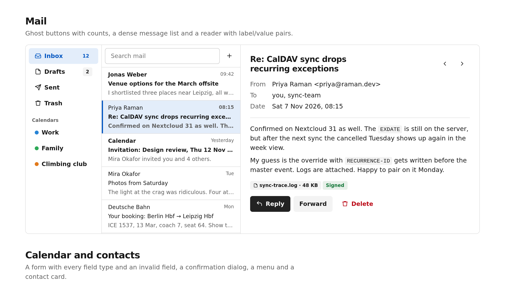

# temper

CSS for plain, semantic HTML with a checked vocabulary, designed so coding agents get it right the first time.

**Compact** core · **20 / 20** agent tasks correct, against 11 for Pico and 10 for daisyUI ·
**4,750 → 210** lines of app CSS in a real migration · **no** JS, build step or dependencies

<picture>
  <source media="(prefers-color-scheme: dark)" srcset="docs/screenshots/app-dark.png">
  
</picture>

This app shell ([`kitchen-sink/app.html`](kitchen-sink/app.html)) has no CSS of its own. The
screenshot follows your GitHub theme: switch between light and dark to see the other mode.

## A taste

**Write HTML. It already looks finished.**

```html
<form data-layout="stack" data-gap="md">
  <label>Email
    <input type="email" aria-invalid="true">
    <small data-tone="danger">Enter a full address, like name@example.com.</small>
  </label>
  <div data-layout="row" data-gap="sm" data-justify="end">
    <button type="button" data-variant="outline" data-tone="danger">Discard</button>
    <button>Save</button>
  </div>
</form>
```

No classes, no margins. Style (`data-variant`) and color (`data-tone`) are separate axes, so an
outline danger button is just both. `aria-invalid` is the error state *and* the error styling.

**A typo fails the build, and the error tells you the fix.**

```text
$ npx temper check src
page.html:4:13 error TM101 data-variant="danger" is not valid. Did you mean data-tone="danger"? (allowed: secondary, outline, ghost, link, item)
page.html:7:3 error TM103 <button data-icon="x"> has no visible text. Add aria-label.

2 error(s), 0 warning(s); 1 fixable with --fix
```

`--fix` rewrites the safe ones. The Vite plugin runs the same check in every build, and in Svelte,
Vue and JSX it follows expressions: `failed ? 'danger' : 'sucess'` is an error.

**A modal dialog, no JavaScript.**

```html
<button commandfor="confirm" command="show-modal" data-tone="danger">Delete…</button>
<dialog id="confirm">
  <h2>Delete “Team retro”?</h2>
  <footer>
    <button commandfor="confirm" command="close" data-variant="ghost">Keep</button>
    <button data-tone="danger">Delete event</button>
  </footer>
</dialog>
```

`command="show-modal"` is the declarative `showModal()`: the button opens the dialog as a modal,
with no script. It animates in and out, blocks the page behind it and closes on Escape. That's the
browser's own `<dialog>`, styled.

**Rebrand with two numbers.**

```css
:root { --tm-hue: 180; --tm-chroma: 0.12; }   /* teal, in light and dark mode */
```

Every color is derived from those in OKLCH, and a test sweeps all 360 hues to keep text and buttons
at WCAG AA contrast in both modes.

**A dark section on a light page is one attribute.**

```html
<section data-theme="dark" data-pad="xl">…</section>
```

**Your CSS always wins.** Everything lives in `@layer tm.*` behind `:where()`, so `.card { padding: 2rem }`
beats it. You never need `!important`.

## Quick start

```sh
npm install @tiaforge-ui/temper
```

```js
import '@tiaforge-ui/temper/core.css';
```

Then tell your agent about it, in `CLAUDE.md` or `AGENTS.md`:

```md
UI uses temper. Read node_modules/@tiaforge-ui/temper/llms.txt before editing markup
(llms-full.txt before building whole pages). Run `npx temper check src` after editing.
```

The optional modules, the Vite plugin and use without a bundler are under [Install](#install).

## Screenshots

Every variant against every tone, plus badges, callouts and form controls:

<picture>
  <source media="(prefers-color-scheme: dark)" srcset="docs/screenshots/reference-dark.png">
  
</picture>

A mail client from the kitchen sink ([`kitchen-sink/index.html`](kitchen-sink/index.html); the
three-pane layout and the message list use a few lines of demo CSS):

<picture>
  <source media="(prefers-color-scheme: dark)" srcset="docs/screenshots/mail-dark.png">
  
</picture>

`npm run readme-shots` regenerates them (2560×1440).

## What it does differently

**1. The vocabulary is closed and enforced.** Each attribute is one axis with a fixed list of
values, so the checker can do more than catch typos:

- **Placement:** `data-pairs` only on a `dl`, `data-rail` only as a direct child of `[data-shell]`,
  `data-cols` only with `data-layout="grid"`, and `data-rail` needs `app.css` imported somewhere.
- **Expressions:** in Svelte, Vue and JSX it works out every value an expression can produce, and
  flags `cond && 'danger'`, which renders `data-tone="false"`.
- **Types:** `@tiaforge-ui/temper/react`, `/vue`, `/astro`, `/svelte` and `/sinter` let tsc
  reject things like `data-collapsed={collapsed}`, where `false` would render `data-collapsed="false"`.
- **Safe fixes and renames:** `--fix` only applies fixes that can't go wrong (a value moved to its
  axis, a typo with one close match, a value dropped from a boolean). Deprecated names keep working
  until the next major version, with a warning that `--fix` resolves.
- **Accessibility:** buttons without a name and fields without a label (a placeholder doesn't count).
- **Your own CSS**, as warnings, so it doesn't grow back after a migration: `!important`, fixed
  colors that ignore dark mode, outer margins, spacing that equals a scale step (`16px` →
  `var(--tm-space-md)`, fixable), rules that restyle `[data-variant]` instead of setting tokens, and
  `margin`/`padding` in `style`. A `temper-ignore` comment silences one line.

It reads HTML, Svelte, Astro, Vue and JSX, plus `--tm-*` tokens in CSS. With classes none of this is
possible: nothing knows that `.secondary.outline.contrast` is a contradiction.

**2. Nothing has an outer margin.** The parent owns all space: `data-gap` between children,
`data-pad` inside, one scale `xs sm md lg xl` everywhere. This removes the most common failure we saw
with other libraries: agents stacking margin overrides against built-in margins.

**3. State is HTML and ARIA.** `disabled`, `aria-invalid`, `aria-busy` (spinner, blocks input),
`aria-pressed`, `aria-current`, `:user-invalid`, `[open]`, `:popover-open`. Correct accessibility
markup is the styling, so it doesn't get left out.

**4. Modern HTML works as-is.** Dialog invokers, `[popover]` with light dismiss, `role="switch"`
checkboxes, `details`, `dl` as label/value pairs, enter and exit animations with `@starting-style`.
No JS components to wire up.

**5. Dark mode is designed, not inverted.** Colors are declared once with `light-dark()` at fixed
OKLCH lightness; raised surfaces get lighter and accents less saturated in the dark. Add
`--tm-primary: var(--tm-accent)` to give main buttons the brand color.

## Does it work as expected?

These are the things we measured instead of assuming.

**Agent eval, same tasks, three libraries.** Ten UI tasks from a real calendar/mail app (event form,
delete confirmation, outline danger button, invalid field, toolbar, status badges, settings
switches, dark mode, brand color, exact spacing). An agent wrote each one with only the library's
docs as context, two runs per library. A grader then measured the result in headless Chrome at
1024×768, in light and dark mode: colors, contrast, alignment, sizes, gaps, accessible names.

| Library | Tasks fully correct | Checks passed | Classes used |
|---|---|---|---|
| **temper** | **20 / 20** | **142 / 142** | 3 |
| temper, without running the checker | 20 / 20 | 142 / 142 | 2 |
| Pico CSS | 11 / 20 | 131 / 142 | 58 |
| daisyUI | 10 / 20 | 130 / 142 | 243 |

The misses for the others were things a reader won't spot in code review: button text below WCAG
contrast in dark mode, an "outline danger" button that came out blue because there was no way to
combine those two, badges with unreadable text, an icon button that wasn't square. The row without
the checker shows that the vocabulary itself carries most of the weight; the checker is the safety
net. (It's a small sample: 10 tasks × 2 runs. The harness and task list are not in this repository, so take these as
reported numbers, not something you can rerun from here.)

**A real migration.** caley, a calendar, mail and contacts app, was moved from Pico CSS to temper
page by page: contacts, mail, calendar, search, settings and login, including the Svelte components
they share. A coding agent did the work from the docs, in four steps.

| | Pico | temper |
|---|---|---|
| App CSS (SCSS and component styles) | about 4,750 lines | about 210 lines |
| CSS shipped to the contacts page (gzip) | about 15.8 KB | 6.5 KB |
| Pico in sources or build output | everywhere | none |
| Inspector errors on the six pages | | 0 |

What's left in the app is mostly inline custom properties like `style="--tm-min: 13rem"` and a few
app-specific rules. The navigation rail with collapse and phone drawer, avatars, clickable cards,
dropdown menus and checklists, the combobox, calendar grids and event chips, tabs and list rows,
dialogs and the floating action button all come from the library. For comparison, a separate Pico
rewrite of the contacts page alone still needed 134 lines of custom CSS. Every gap the migration hit
went back into the library or its docs; the ranked list is in
[`docs/backlog-from-caley.md`](docs/backlog-from-caley.md).

**Tests keep the docs honest.** `npm test` asserts that every attribute and value in `vocab.json`
has a CSS selector and every selector has a vocab entry, that every documented token is declared,
and that `llms.txt`, `llms-full.txt` and `html-custom-data.json` are regenerated from `vocab.json`
and not stale. Docs, editor autocomplete and the checker can't drift apart from the CSS.

**Contrast is checked for every hue.** `npm run contrast` sweeps the accent hue 0–360 in light and
dark mode, lets headless Chrome resolve the real tokens, and checks WCAG AA for every text and
background pair (4.5:1 for text and solid buttons, 3:1 for the focus ring). All hues pass at the
default chroma. `npm test` runs the same check for the default look and the two theme examples.

**Visual regression tests.** `npm run visual` screenshots the kitchen sink and the app shell demo in
17 states (light and dark, compact density, phone width, both theme examples, open menu, dialog and
drawer) and compares them pixel by pixel with baselines in `test/visual/`. A change writes a diff
image with the changed pixels in red. Baselines depend on fonts and the Chrome version, so they are
compared on the machine that made them; `npm run visual -- --update` accepts an intended change.

**Size budgets are enforced.** `npm run build` fails above budget: `core.css` 6 KB, `icons.css` 3.5 KB, `all.css` 11.5 KB, every other file 1.5 KB (brotli). They sit a little above the current sizes, so a fix fits and real growth means raising one on purpose.

| File | brotli | What's in it |
|---|---|---|
| `core.css` | 5.5 KB | tokens, reset, type, layout, buttons, forms (incl. meter, color, multi-row select), dialog, popover, details, table, card, badge, callout, avatar |
| `app.css` | 1.4 KB | app shell, navigation rail (collapsible, drawer on phones), floating action button |
| `menu.css` | 0.9 KB | dropdown menus |
| `feedback.css` | 0.8 KB | toasts, tooltips (anchor-positioned, never clipped by a scroll container) |
| `table.css` | 0.7 KB | data tables: sortable headers (`aria-sort`), row selection, number columns, sticky header |
| `icons.css` | 3.0 KB | 56 default [Lucide](https://lucide.dev) icons via `data-icon` |
| `all.css` | 10.2 KB | everything |
| `enhance/customizable-select.css` | 0.9 KB | opt-in: the open `<select>` list styled like a menu (see below) |

## Built for LLMs and coding agents

- **[`llms.txt`](llms.txt)** (~140 lines): rules, every attribute and value, tokens, icons and an
  anti-pattern table ("don't / do"). Enough for small edits.
- **[`llms-full.txt`](llms-full.txt)**: every attribute in detail plus copy-paste recipes: form,
  card, dialog, toolbar, status, settings rows, app shell, dropdown, card grid, label/value pairs,
  page layout. Agents copy recipes instead of inventing markup.
- **Names that don't collide with habits.** No numeric spacing (agents read `4` as Tailwind's 1rem),
  no `.btn-primary`. Values like `secondary outline ghost link` follow shadcn, which models have seen
  a lot.
- **`temper check`** gives the agent a precise, fixable error instead of a silently wrong page.
- **[`temper-inspect`](packages/inspect/README.md)** replaces the screenshot loop. It loads a running
  page in headless Chrome at a wide and a narrow width, in light and dark mode, opens every dialog and
  popover through its real button, and reports horizontal overflow, misplaced overlays, low contrast,
  unlabeled controls and covered click targets as text, with a selector for each. `--sheet` writes
  one contact-sheet image per page when you do want to look.
- **`html-custom-data.json`** gives VS Code (and other editors) autocomplete and hover docs for every
  attribute value.

## Install

```sh
npm install @tiaforge-ui/temper
```

```js
import '@tiaforge-ui/temper/core.css';   // always
import '@tiaforge-ui/temper/app.css';    // app shell, navigation rail, floating action button
import '@tiaforge-ui/temper/menu.css';   // dropdown menus
import '@tiaforge-ui/temper/feedback.css'; // toasts, tooltips
import '@tiaforge-ui/temper/table.css';  // data tables
import '@tiaforge-ui/temper/icons.css';  // the default icon set
// or everything: import '@tiaforge-ui/temper/all.css';
```

Add `<meta name="color-scheme" content="light dark">` to avoid a flash of the wrong theme on load.

### Vite plugin

```js
// vite.config.js
import temper from '@tiaforge-ui/temper/vite';

export default {
  plugins: [
    temper(),
    // every Lucide icon by name, only the used ones emitted, plus your own SVG folder:
    // temper({ icons: { dir: 'src/icons' } })   and   import 'virtual:temper-icons.css';
    // migrating step by step? check only the migrated parts:
    // temper({ paths: ['src/contacts'] })
    // opt-in enhancements, appended to core.css / all.css (see Browser support):
    // temper({ enhance: ['customizable-select'] })   or   enhance: 'all'
    // smaller builds: drop rules for data-* attributes and values the project never uses
    // temper({ prune: true })
    // rendered-page findings in the dev terminal (overflow, contrast, clipped text); needs temper-inspect installed
    // temper({ inspect: true })
  ],
};
```

`prune` scans every source file under the Vite root (or `prune: { paths }`) and only drops a rule
when an attribute or value it requires appears nowhere. Values it can't resolve (`data-icon={icon}`)
keep every value of that attribute, and `data-*` names in scripts (`el.dataset.tone = …`) keep the
whole attribute. Gains depend on how much is computed: about 8% of `all.css` for caley, where icons
and tones are mostly computed. `npm run visual:prune` checks that pruning changes nothing visible in
the kitchen sink.

`inspect: true` (with `@tiaforge-ui/temper-inspect` installed) runs that package's audit inside the page your dev
server serves: after load, after every hot update and when the page changes. What it finds (overflow, contrast,
clipped text) is printed in the terminal next to the static check's diagnostics, once per change, with a selector
instead of a file and line. It sees the page as it is now; it does not open dialogs or resize the window, which
`temper-inspect` does in headless Chrome (use that in CI). Dev server only, never in a build.

Icons from the plugin need `lucide-static` installed (optional peer dependency).

### Without a bundler

The files in `dist/` are plain CSS. Link them directly and run `npx temper check` in CI.
Enhancements are separate files: link `dist/enhance/<id>.css` after `core.css`.

## Browser support

Chrome / Edge 123+, Firefox 120+, Safari 17.5+ (Baseline 2024, set by `light-dark()`). No vendor
prefixes and no fallbacks for older browsers; that is part of how it stays small.

Newer features that not every engine has yet are **opt-in enhancements**, one file each, named by
their [web-features](https://github.com/web-platform-dx/web-features) id. Without them everything
still looks finished. Turn them on with the Vite plugin's `enhance` option, or import
`@tiaforge-ui/temper/enhance/<id>.css` after `core.css`.

| Enhancement | What it does | Where it works |
|---|---|---|
| `customizable-select` | `appearance: base-select`: the open list of a single `<select>` gets the menu look, an accent checkmark, styled `optgroup`/`hr`, and rich options via `<selectedcontent>` | Chromium 135+; other browsers keep the native picker |

## More

- [`llms-full.txt`](llms-full.txt): the complete reference (it's written for agents, and it's the
  best human reference too).
- [`kitchen-sink/`](kitchen-sink/): every component, app-like screens, and two alternative themes
  in [`theme-examples.css`](kitchen-sink/theme-examples.css).
- [`SPEC.md`](SPEC.md): design principles and the reasoning behind them.

## License

MIT. The default icons are from [Lucide](https://lucide.dev) (ISC, see `LICENSE-lucide`).
